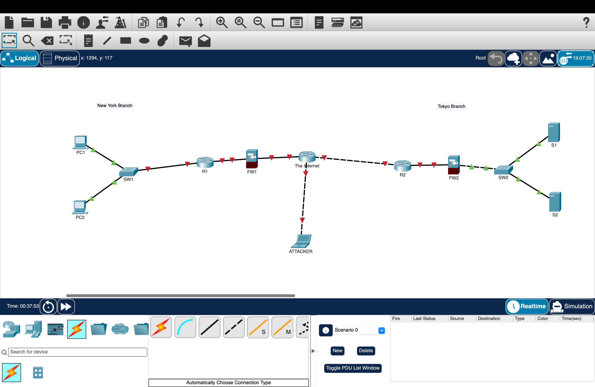

# Day 1 – Network Devices Lab

## Objective
To recreate a basic network topology using Cisco Packet Tracer and become familiar with different networking devices.

## Tools Used
- Cisco Packet Tracer

## Devices Used
- 2 Cisco 2911 Routers
- 2 Cisco 2960 Switches
- 2 Cisco ASA 5505 Firewalls
- 2 PCs
- 2 Servers
- 1 Laptop (Attacker)

## Lab Activities
1. Added the required network devices in Cisco Packet Tracer.
2. Arranged the devices into two branches: New York and Tokyo.
3. Connected the devices using the automatic connection feature.
4. Added an attacker laptop to the Internet portion of the topology.
5. Recreated the network topology shown in the course.

## Network Topology

## What I Learned
- How to identify common networking devices.
- The basic functions of routers, switches, and firewalls.
- How end devices connect to a network.
- How to create and connect a network topology in Cisco Packet Tracer.

## Reference
Jeremy's IT Lab – CCNA 200-301, Day 1 Lab