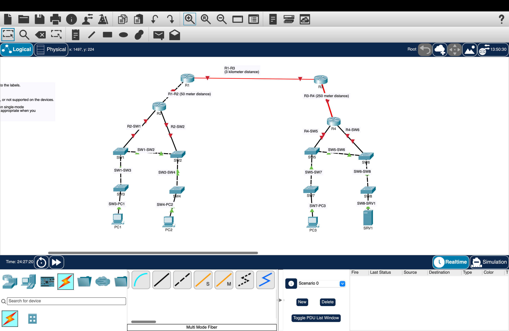

# Day 2 – Connecting Devices Lab

## Objective
To practice connecting network devices using appropriate cables and interfaces in Cisco Packet Tracer.

## Tools Used
- Cisco Packet Tracer

## Lab Activities
1. Examined the network topology and identified the required connections.
2. Connected routers and switches using appropriate cable types.
3. Practiced selecting the correct network interfaces.
4. Used single-mode fiber for the 3 km connection between R1 and R3.
5. Installed compatible fiber network modules to resolve a cable-to-port compatibility issue.
6. Completed the physical network topology.

## Network Topology

## Troubleshooting
**Issue:** The error "The cable cannot be connected to that port" appeared when connecting a single-mode fiber cable.

**Cause:** The selected interface did not support the required fiber connection.

**Solution:** Installed a compatible single-mode fiber network module and selected the appropriate interface.

## What I Learned
- The differences between network cable types.
- How cable selection depends on connection distance and interface compatibility.
- How to identify and select network interfaces.
- How to install network modules in Cisco Packet Tracer.
- How to troubleshoot cable and port compatibility issues.

## Course Reference
Jeremy's IT Lab – CCNA 200-301, Day 2 Lab